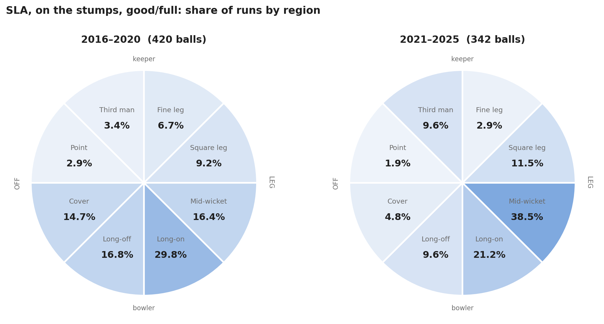
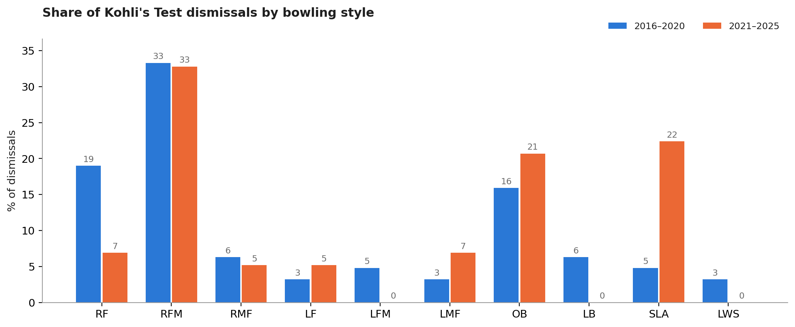

# Virat Kohli's Post-2020 Test Decline: What Actually Changed

Ball-by-ball analysis of Virat Kohli's Test batting, comparing **2016–2020** (peak) with **2021–2025** (decline).

📄 **Article:** [Read on Medium](https://medium.com/@y.ritvik45/virat-kohlis-post-2020-decline-what-actually-changed-in-his-batting-test-cricket-504287971a69)
📓 **Notebook:** [Kohli_Analysis.ipynb](Kohli_Analysis.ipynb)

## Key findings
| | 2016–2020 | 2021–2025 |
|---|---|---|
| Median runs per innings | 40 | 20 |
| Balls faced vs slow left-arm orthodox (SLA) | 843 | 821 |
| Dismissals vs SLA | 3 | 13 |
| Dismissals per 100 balls vs all spin | 0.66 | 1.49 |

- The drop against spin was concentrated in **SLA**: same exposure, far more dismissals.
- On the stumps he **stopped driving and started defending**; his scoring moved to mid-wicket and cover became a dot-ball zone.
- In England he left more balls outside off but was still out inside 40 balls in 7 of 13 innings; in South Africa the same approach helped him survive.

## Data checks
Two issues in the raw data were found and handled (details in the notebook appendix):
- Rows within an innings are **not stored in ball order**, so "first N balls" uses `cur_bat_bf` (balls faced so far).
- Some dismissal rows belong to the **non-striker** (partner run-outs) and are excluded.

## How to run
1. Get the Test ball-by-ball dataset from Himanish Ganjoo's cricket data (not included here).
2. Save it as `TestData.csv` in the same folder as the notebook (or change `DATA_PATH` in the Setup cell).
3. `pip install -r requirements.txt`, then open the notebook and run all cells.

## Tools
Python · pandas · NumPy · Matplotlib · Jupyter
